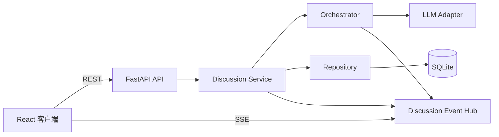
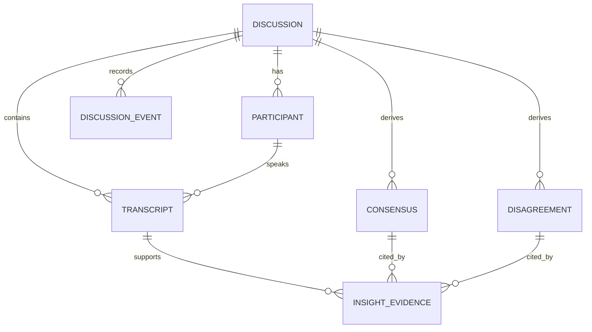
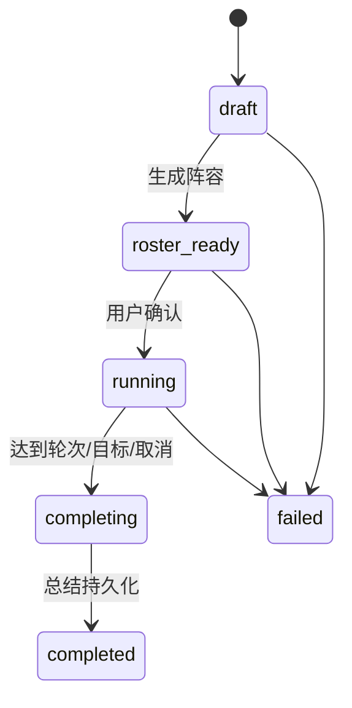

# 初步架构方案

## 技术选型
推荐 React + TypeScript + Vite、FastAPI、SQLAlchemy + SQLite、SSE、pytest 与 Playwright。LLM 仅由后端经 OpenAI-Compatible 适配器调用。该组合满足本地 MVP，避免微服务与非必要依赖。

## 总体架构

## 模块职责
| 模块 | 职责 |
|---|---|
| API | 请求校验、资源路由、错误映射、SSE 订阅边界 |
| Discussion Service | 生命周期、事务、多讨论边界 |
| Orchestrator | 选行动、上下文、限轮次与结束条件 |
| LLM Adapter | Prompt、结构化输出、超时/重试/归一化 |
| Repository | 持久化访问 |
| Event Hub | 按 discussion_id 广播与重放 |
| UI | 列表、阵容确认和独立滚动的演播厅 |

## 实体关系

Discussion 管理议题、状态、轮次与版本；Participant 是身份/立场；Transcript 是公开事实；Event 是运行审计与同步；共识/分歧含证据锚点。字段与迁移留待阶段 1。

## 生命周期和调度

每场有独立 OrchestrationSession 和事实记录。每步读取有限上下文，根据主持节奏、回应相关性、分歧、观点覆盖、发言冷却与剩余轮次选择 `moderate/invite/rebut/elaborate/close`。规则层约束上限/冷却/结束，模型只出候选，确保动态可控。公开回复校验角色、JSON Schema、1–2 句及字符上限；失败最多一次纠正重试，随后显式失败。

## API、SSE、隔离与错误
REST 按 discussions、roster、lifecycle、transcripts、insights 分类，使用版本化 DTO，不暴露 ORM/原始模型 JSON。SSE 事件含 `id,type,discussion_id,occurred_at,payload`；类型包括状态变更、发言、洞见、生命周期、错误。客户端以 Last-Event-ID 重连，服务端从持久化事件补发后订阅 Hub。Transcript 是业务事实，事件是变化通知/审计。

所有查询、缓存键、SSE 通道、编排任务和前端 store 均以 discussion_id 分区，禁止“当前讨论”全局变量。短事务写入，SQLite 是单进程 MVP 约束。输入为可读 4xx，非法状态为冲突；模型超时/格式错误记录受限诊断并广播可恢复错误，不泄露密钥/Prompt。

## 待确认决策
推荐专家数 2–6、默认最多 12 条公开发言、模型格式纠正重试 1 次、用户可停止讨论。阶段 1 前需确认；否则按此作暂定 API/Schema 契约。
