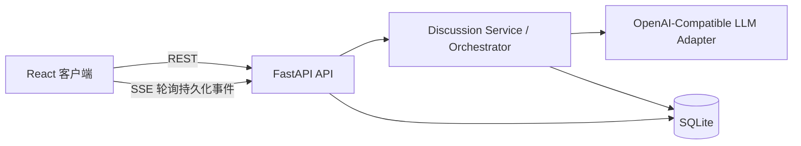
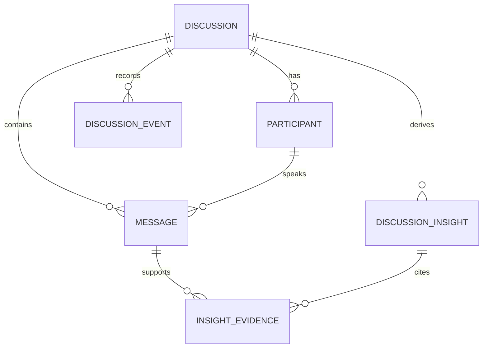
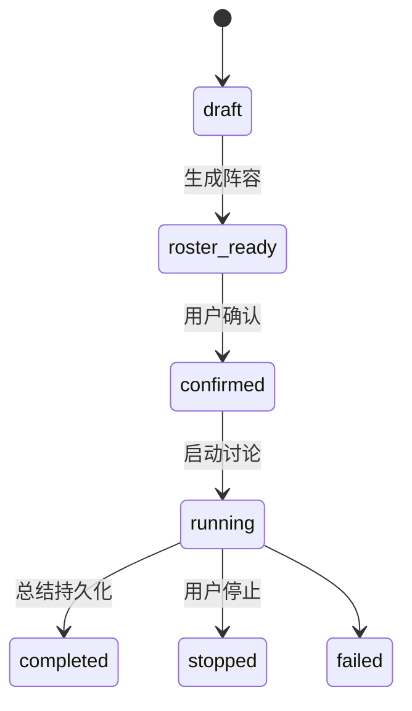

# 实际架构方案

## 技术选型
推荐 React + TypeScript + Vite、FastAPI、SQLAlchemy + SQLite、SSE、pytest 与 Playwright。LLM 仅由后端经 OpenAI-Compatible 适配器调用。该组合满足本地 MVP，避免微服务与非必要依赖。

## 总体架构

## 模块职责
| 模块 | 职责 |
|---|---|
| API | 请求校验、资源路由、错误映射、SSE 订阅边界 |
| Discussion Service / Orchestrator | 生命周期、短事务、模型调度、上下文、限轮次与讨论级锁 |
| LLM Adapter | Prompt、结构化输出、超时/重试/归一化 |
| SQLAlchemy Session | 直接访问 SQLite；本 MVP 未额外实现 Repository 抽象 |
| Persisted SSE stream | 按 discussion_id 与 sequence 轮询、回放 `discussion_events`；没有独立内存 Event Hub |
| UI | 列表、阵容确认和独立滚动的演播厅 |

## 实体关系

Discussion 管理议题和生命周期；Participant 是身份/公开立场；Message 是公开 Transcript 事实；DiscussionEvent 是运行审计与 SSE 数据源；DiscussionInsight 以 kind 区分共识/分歧，并通过 InsightEvidence 关联真实 Message。完整字段见 `docs/SCHEMA.md`。

## 生命周期和调度

每场由 `DiscussionManager` 维护按 discussion_id 分区的 asyncio Task 和 Lock；业务事实全部写入 SQLite，不存在独立 OrchestrationSession 存储。每一步把议题、嘉宾公开立场、最近八条发言、发言次数、尚未参与专家和剩余预算交给模型，由模型提出 speaker/action/text/focus/finish。程序校验角色动作、首轮主持、禁止连续独白、句数/160 字、重复内容、全员参与和预算覆盖；失败最多纠正一次。动作集合是 `open/invite/answer/add/rebut/question/interrupt/moderate`，最终总结是单独的 `summary` Message。

## API、SSE、隔离与错误
REST 按 discussions、roster、lifecycle、transcript、insights 分类，使用 Pydantic DTO，不直接返回 ORM。SSE 帧的 `id` 是场内事件 sequence，`event` 是事件类型，`data` 含 `discussion_id、sequence、type、payload`；当前 wire data **没有** `occurred_at` 字段。客户端用 `after` 或 `Last-Event-ID` 补读，服务端持续轮询 `discussion_events`，终态补发完毕后关闭。Transcript 是业务事实，事件是变化通知与审计；举手、准备和发言状态不会写入 Message。

所有查询、SSE 读取、编排任务和前端当前视图均以 discussion_id 校验或分区。短事务写入，SQLite 是单进程 MVP 约束。输入为可读 4xx，非法状态为冲突；模型超时/格式错误在阵容阶段返回 502，在运行阶段写 `discussion.error` 并转为 failed，不泄露密钥或完整 Prompt。

## 待确认决策
已确认：专家数 2–6（默认 4）；公开发言预算默认约 18 条、上限 24 条且可提前结束；模型格式纠正重试最多 1 次；用户可停止并保留已有数据。所有讨论的上下文、数据、事件和任务必须隔离。

## 阶段 3 实现说明

后端的 `DiscussionManager` 只保存按讨论 ID 分区的运行任务与异步锁；所有业务事实写入 SQLite。每次模型调用在数据库事务外等待，发言、状态和洞见相关事件在短事务内持久化。调度提示词基于最近八条发言、嘉宾立场、发言次数与预算，由模型提议下一行动，程序核验角色、长度、重复发言和首轮主持约束。公开发言按中文句界收束到两句和 160 字以内；摘要由主持人单独生成。

事件流从 `discussion_events` 按 `(discussion_id, sequence)` 查询并补发；客户端以序号和消息 ID 去重。单进程内每场讨论只允许一个任务。服务启动时将遗留 `running` 标记为 `failed`，保留历史发言。当前不支持多 worker 共同调度，也不自动续跑重启前的讨论。

阶段 4 浏览器验收使用真实 Vite/FastAPI/SSE 路径，但模型依赖替换为进程内 Fake LLM，数据库置于临时目录。真实运行时模型仍由后端读取环境变量。讨论预算将最后一条主持总结计入总数；终态 UI 不建立 SSE 连接，避免把服务端正常结束误报为断线。三栏桌面布局保持不变，窄屏将面板纵向重排，Transcript 保持独立滚动并尊重用户查看历史的位置。
